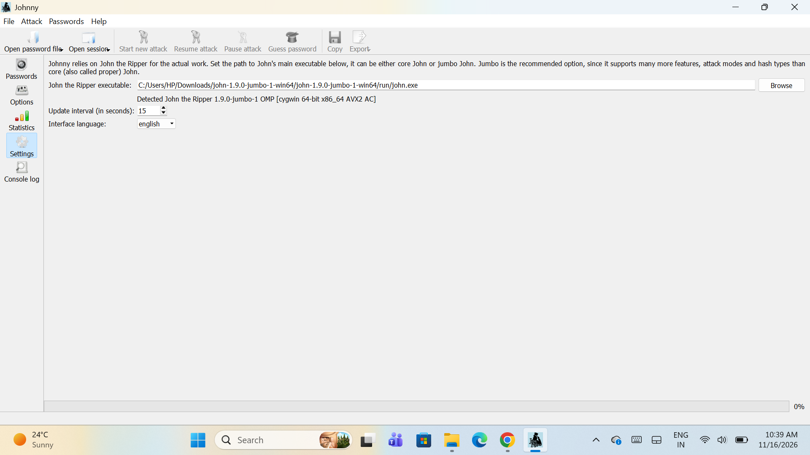
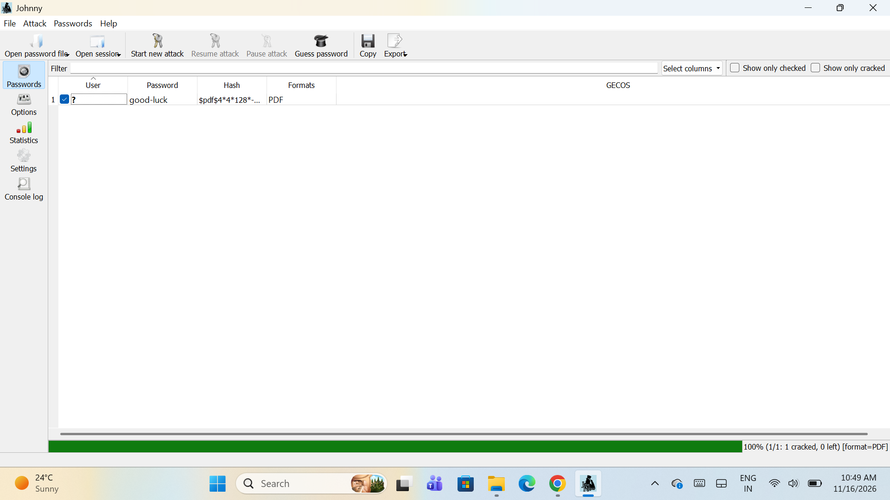
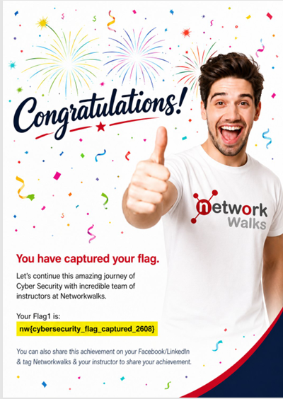

# Hash Learning: Document Hash Analysis & Weak-Value Risk Awareness

**Cybersecurity Internship Project — Networkwalks (Week 3)**

## Overview

This repo documents two hands-on exercises in extracting and analyzing a PDF's security hash, to understand how predictable values can be matched using open dictionaries. The goal is to build awareness of why strong, unique values matter for document security — not to promote unauthorized access to protected files.

All testing was performed on a self-generated test file (`My Locked PDF1.pdf`) in a controlled training environment as part of the Networkwalks Cybersecurity & Ethical Hacking internship program.

**Methods covered:**
- ✅ Method 1: John the Ripper (JTR) + Johnny GUI
- ⬜ Method 2: Networkwalks Hash Calculator + Comparison Tool *(coming soon)*

---

## Method 1: John the Ripper + Johnny GUI

### Tools used
- [John the Ripper (jumbo)](https://www.openwall.com/john/) — hash analysis engine
- [Johnny](https://openwall.info/wiki/john/johnny) — GUI front-end for John the Ripper
- [Online Hash Crack — PDF Hash Extractor](https://www.onlinehashcrack.com/tools-pdf-hash-extractor.php) — converts a locked PDF into an analyzable hash

### Process

**Step 1 — Download & set up John the Ripper**
Downloaded the 64-bit jumbo Windows build and extracted it. `john.exe` is located inside the `run` subfolder.

**Step 2 — Install Johnny GUI**
Installed Johnny via `johnnyInstaller.exe`. On first launch, the table is empty and no comparison has been run yet.

**Step 3 — Link Johnny to John the Ripper**
In Settings, browsed to `john.exe` and confirmed detection.

> Detected: `John the Ripper 1.9.0-jumbo-1 OMP [cygwin 64-bit x86_64 AVX2 AC]`

**Step 4 — Extract the PDF's hash**
Uploaded `My Locked PDF1.pdf` to the Online Hash Crack PDF Hash Extractor to obtain a `$pdf$...` hash for analysis.

**Step 5 — Save the hash to a file**
Copied the full hash into Notepad and saved it as `hash1.txt`.

**Step 6 — Load the hash into Johnny**
Used *Open password file → PASSWD format* to load `hash1.txt`. Johnny correctly identified the format as `PDF`.

**Step 7 — Run the comparison**
Started the dictionary comparison via *Start new attack*. Johnny completed at 100% with a match found.

| User | Matched Value | Format | Result |
|------|---------------|--------|--------|
| ? | `good-luck` | PDF | 1 matched, 0 left |

**Step 8 — Unlock & verify**
Opened `My Locked PDF1.pdf`, entered the matched value, and confirmed the flag.

> **Flag captured:** `nw{cybersecurity_flag_captured_2608}`

### Result
The value **`good-luck`** was matched in a single automated dictionary pass, confirming that short, common, dictionary-style values offer minimal protection against freely available hash analysis tools.

---

## Method 2: Networkwalks Hash Calculator + Comparison Tool

*TODO — write-up and screenshots to be added*

<!--
Suggested structure once ready:
### Tools used
- Networkwalks Hash Calculator (https://networkwalks.com/hash-calculator/)
- Networkwalks Comparison Tool (https://networkwalks.com/password-cracker/)

### Process
1. Upload PDF to Hash Calculator → extract $pdf$ hash
2. Copy hash into the Comparison Tool
3. Select wordlist (built-in or custom)
4. Run comparison → observe live dictionary attempts
5. Capture matched value
6. Unlock PDF to verify

### Result
-->

---

## Key Takeaways

- A simple 8-character lowercase value can be matched in minutes; a strong 12+ character mixed value can take years to resolve.
- Over 24 billion username/value pairs are already circulating from past breaches.
- Predictable patterns remain among the most common values used worldwide.
- Document encryption is only as strong as the value chosen — the hash algorithm itself is not the weak point, predictability is.

## Disclaimer

This project was completed for educational purposes as part of an authorized cybersecurity training program (Networkwalks internship), focused on hash learning and encryption awareness. All testing was performed on a self-owned test file. These techniques should only be used on systems/files you own or have explicit written authorization to test.
